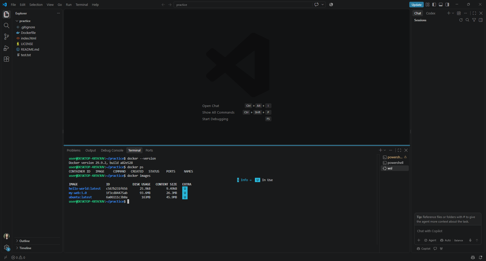

# AI/SW 개발 워크스페이스 구축 및 Docker 실습 보고서

Windows 11, WSL2 Ubuntu, Docker Desktop, Git, GitHub, VS Code를 연결해 개발 워크스페이스를 구성하고 Nginx 웹 서버를 컨테이너로 실행한 기록이다. 아래에는 설정 설명뿐 아니라 명령어, 실제 출력, 재현 절차와 문제 해결 근거를 함께 기록했다.

## 1. 실습 환경

- OS(운영체제): Windows 11
- Linux 환경: WSL2 Ubuntu
- Container runtime(컨테이너 실행 환경): Docker Desktop + WSL2 Integration(WSL2 연동)
- Editor(편집기): Visual Studio Code
- Version control(버전 관리): Git + GitHub
- Repository(저장소): <https://github.com/gippm00/codyssey>
- 제출 브랜치: `main`

### Docker 버전 및 엔진 확인

실행 명령어:

```bash
docker --version
```

실제 출력:

```text
Docker version 29.9.2, build a82e528
```

Docker 명령이 WSL2 Ubuntu에서 정상 실행되고 `docker ps`, `docker images`, 컨테이너 시작까지 성공했으므로 Docker daemon(도커 데몬, 컨테이너를 실제로 관리하는 백그라운드 서비스)과 연결된 상태임을 확인했다. 추가 점검에는 다음 명령을 사용한다.

```bash
docker info
```

## 2. Linux CLI 기초와 권한

### 파일 및 디렉터리 확인

```bash
ls -la
```

실제 출력:

```text
total 40
drwxr-xr-x 3 user user 4096 Nov  5 11:29 .
drwxr-x--- 7 user user 4096 Nov  5 10:57 ..
drwxr-xr-x 7 user user 4096 Nov  5 11:46 .git
-rw-r--r-- 1 user user 4664 Nov  5 11:26 .gitignore
-rw-r--r-- 1 user user   67 Nov  4 15:32 Dockerfile
-rw-r--r-- 1 user user 1064 Nov  5 11:26 LICENSE
-rw-r--r-- 1 user user  884 Nov  5 11:29 README.md
-rw-r--r-- 1 user user   44 Nov  4 15:32 index.html
-rwxr-xr-x 1 user user   12 Nov  4 12:36 test.txt
```

### `chmod 755` 권한 적용과 의미

```bash
chmod 755 test.txt
ls -l test.txt
```

확인 결과:

```text
-rwxr-xr-x 1 user user 12 Nov 4 12:36 test.txt
```

`755`는 소유자(owner)에게 읽기·쓰기·실행 권한인 `rwx`를, 그룹(group)과 기타 사용자(others)에게 읽기·실행 권한인 `r-x`를 부여한다. 숫자는 `r=4`, `w=2`, `x=1`을 더해 계산한다. 따라서 `7=4+2+1`, `5=4+1`이며 기호 표기는 `rwxr-xr-x`이다.

## 3. 프로젝트 디렉터리 구조

```text
practice/
├── .git/                 # Git 저장소 메타데이터
├── .gitignore            # Git 추적 제외 규칙
├── Dockerfile            # Nginx 이미지 빌드 명세
├── index.html            # 웹 서버에서 제공할 HTML
├── LICENSE               # 라이선스
├── README.md             # 실습·재현·검증 보고서
├── docker-status.png     # Docker 실행 증거 화면
└── test.txt              # Linux 권한 실습 파일
```

## 4. Docker 이미지 빌드

### Dockerfile

```dockerfile
FROM nginx:alpine
COPY index.html /usr/share/nginx/html/index.html
```

- `FROM nginx:alpine`: 용량이 작은 Alpine Linux 기반 Nginx 이미지를 base image(기반 이미지)로 사용한다.
- `COPY`: host(호스트)의 `index.html`을 image(이미지) 내부의 Nginx 기본 문서 경로로 복사한다.

빌드 명령:

```bash
docker build -t my-web:1.0 .
```

캐시 때문에 수정 사항이 반영되지 않을 때의 재빌드 명령:

```bash
docker build --no-cache -t my-web:1.0 .
```

`docker images` 확인 결과:

```text
IMAGE                ID             DISK USAGE   CONTENT SIZE
hello-world:latest   c567b231f656       25.9kB         9.49kB
my-web:1.0           1f3cd84475ab       93.6MB         26.3MB
ubuntu:latest        6a06111c3b0a        163MB         45.9MB
```

`my-web:1.0`이 목록에 나타나므로 Dockerfile 빌드 결과가 이미지로 저장되었음을 확인했다.

## 5. 이미지와 컨테이너의 차이

- Image(이미지): 애플리케이션, 라이브러리, 설정을 담은 읽기 전용 설계도이다. `docker build`로 만든다.
- Container(컨테이너): 이미지를 실행해 만든 격리된 프로세스이다. `docker run` 또는 `docker start`로 실행한다.
- 변경 흐름: Dockerfile 또는 웹 파일 수정 → 이미지 재빌드 → 기존 컨테이너 교체 또는 새 컨테이너 실행 → 브라우저로 검증한다.

## 6. Hello World 및 컨테이너 목록 검증

테스트 명령:

```bash
docker run hello-world
```

실행 후 `docker ps -a`에서 `hello-world` 컨테이너가 `Exited (0)`으로 표시되었다. 종료 코드 `0`은 테스트 프로그램이 정상 완료되었다는 의미이다.

```text
CONTAINER ID   IMAGE         STATUS                        NAMES
49c58fc4328a   ubuntu        Exited (255)                  vol-test2
4fb238668497   my-web:1.0    Exited (255)                  my-first-server
4f4eb8584aaa   hello-world   Exited (0)                    sweet_shannon
```

`docker ps`는 현재 실행 중인 컨테이너만, `docker ps -a`는 종료된 컨테이너까지 모두 보여준다.

## 7. Nginx 웹 서버 실행과 포트 매핑

최초 실행 명령:

```bash
docker run -d --name my-first-server -p 8080:80 my-web:1.0
```

이미 만들어진 컨테이너를 다시 시작한 명령:

```bash
docker start my-first-server
```

실행 상태:

```text
CONTAINER ID   IMAGE        STATUS              PORTS                                     NAMES
4fb238668497   my-web:1.0   Up About a minute   0.0.0.0:8080->80/tcp, [::]:8080->80/tcp   my-first-server
```

### 포트 매핑의 의미

`-p 8080:80`에서 앞의 `8080`은 host(Windows/WSL)의 포트이고 뒤의 `80`은 container(컨테이너) 내부 Nginx 포트이다. 컨테이너는 별도의 network namespace(네트워크 네임스페이스, 격리된 네트워크 공간)를 사용하므로 이 매핑이 있어야 호스트 브라우저가 컨테이너의 80번 포트에 접근할 수 있다.

### 접속 확인

```bash
curl http://localhost:8080
```

응답 내용:

```html
<h1>Hello from My First Docker Server!</h1>
```

브라우저에서도 <http://localhost:8080>에 접속해 같은 문구가 표시됨을 확인했다.

### 실행 증거 화면



## 8. 호스트 경로와 컨테이너 경로

- `~/practice/index.html`: WSL2 Ubuntu 호스트에 있는 원본 파일이다.
- `/usr/share/nginx/html/index.html`: Nginx 컨테이너 이미지 내부에서 웹 문서로 제공되는 파일이다.
- Dockerfile의 `COPY`는 빌드 시점에 호스트 파일을 이미지 내부 경로로 복사한다. 원본을 나중에 바꾸어도 이미 실행 중인 컨테이너에는 자동 반영되지 않으므로 이미지를 재빌드해야 한다.

## 9. Docker Volume 데이터 영속성

Volume(볼륨)은 컨테이너의 writable layer(쓰기 계층)와 분리된 Docker 관리 저장 공간이다. 따라서 컨테이너를 삭제하고 새 컨테이너를 만들어도 같은 볼륨을 마운트하면 데이터가 남는다.

재현 절차:

```bash
docker volume create practice-data
docker run --name vol-test1 -v practice-data:/data ubuntu sh -c "echo volume-data > /data/result.txt"
docker rm vol-test1
docker run --name vol-test2 -v practice-data:/data ubuntu cat /data/result.txt
```

마지막 컨테이너에서 `volume-data`가 출력되면 컨테이너 삭제 후에도 데이터가 보존된 것이다. 실습에서 `vol-test2`를 사용해 데이터 보존을 확인했다.

### 데이터 손실 방지 대안

- Named volume(이름 있는 볼륨): Docker가 경로와 수명 주기를 관리하므로 일반적인 영속 데이터에 적합하다.
- Bind mount(바인드 마운트): 호스트의 명시적 경로를 연결하므로 개발 중 소스 공유와 직접 백업에 편리하다.
- Backup(백업): 중요한 볼륨은 별도 파일로 주기적으로 내보내고 복구 절차도 함께 시험해야 한다.

## 10. Git과 GitHub 검증

### 원격 저장소

```bash
git remote -v
```

출력:

```text
origin  https://github.com/gippm00/codyssey.git (fetch)
origin  https://github.com/gippm00/codyssey.git (push)
```

### 동기화 상태

```bash
git status
```

확인 결과:

```text
On branch main
Your branch is up to date with 'origin/main'.

nothing to commit, working tree clean
```

### 최근 커밋 기록

```bash
git log --oneline --decorate -5
```

출력:

```text
e95275a (HEAD -> main, origin/main) merge: sync remote main
837c1f2 feat: complete docker and linux environment setup
3d30d28 Initial commit
```

## 11. 포트 충돌 진단과 해제

8080 포트가 이미 사용 중이면 컨테이너 실행 시 `port is already allocated`와 같은 오류가 발생할 수 있다.

진단 순서:

```bash
ss -ltnp | grep :8080
docker ps --format "table {{.Names}}\t{{.Ports}}"
```

해결 방법:

```bash
docker stop my-first-server
```

기존 서비스를 유지해야 한다면 다른 호스트 포트를 선택한다.

```bash
docker run -d --name my-second-server -p 8081:80 my-web:1.0
```

즉, 먼저 점유 프로세스 또는 컨테이너를 확인하고, 불필요한 서비스를 중지하거나 충돌하지 않는 포트로 변경한다.

## 12. 트러블슈팅

### 이슈 1: WSL2 Ubuntu에서 `docker` 명령을 찾지 못함

1. 가설: Docker Desktop과 Ubuntu 배포판의 연동이 비활성화되었다.
2. 확인: Ubuntu 터미널에서 `docker --version`을 실행했으나 명령을 찾지 못했다.
3. 조치: Docker Desktop의 `Settings > Resources > WSL integration`에서 Ubuntu 연동을 활성화했다.
4. 결과: Ubuntu 터미널에서 Docker 버전, 이미지, 컨테이너 목록이 정상 출력되었다.

### 이슈 2: Dockerfile 경로 오타와 빌드 캐시

1. 가설: Nginx 문서 경로 오타 또는 이전 빌드 캐시 때문에 새 HTML이 반영되지 않았다.
2. 확인: Dockerfile 경로와 컨테이너에서 사용하는 Nginx 기본 경로를 비교했다.
3. 조치: 목적지 경로를 `/usr/share/nginx/html/index.html`로 수정하고 `--no-cache`로 재빌드했다.
4. 결과: `localhost:8080`에서 `Hello from My First Docker Server!`가 정상 표시되었다.

## 13. 최종 검증 체크리스트

- [x] Windows 11 + WSL2 Ubuntu 구성
- [x] Docker Desktop WSL2 연동
- [x] Linux 기본 명령과 `chmod 755` 실습
- [x] Docker 이미지 빌드
- [x] hello-world 정상 종료 코드 확인
- [x] Nginx 컨테이너 실행
- [x] `8080:80` 포트 매핑
- [x] 브라우저와 `curl` 응답 확인
- [x] Docker Volume 데이터 영속성 확인
- [x] Git 원격 저장소와 커밋 기록 확인
- [x] GitHub `main` 브랜치 push
